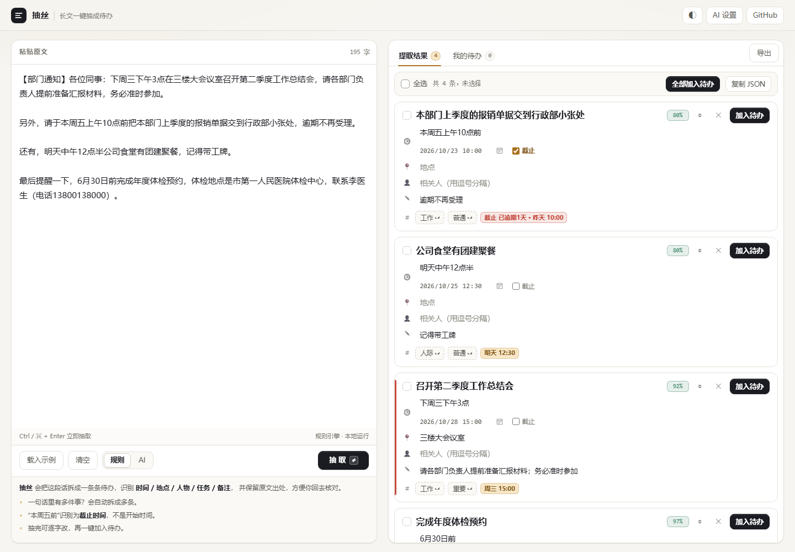
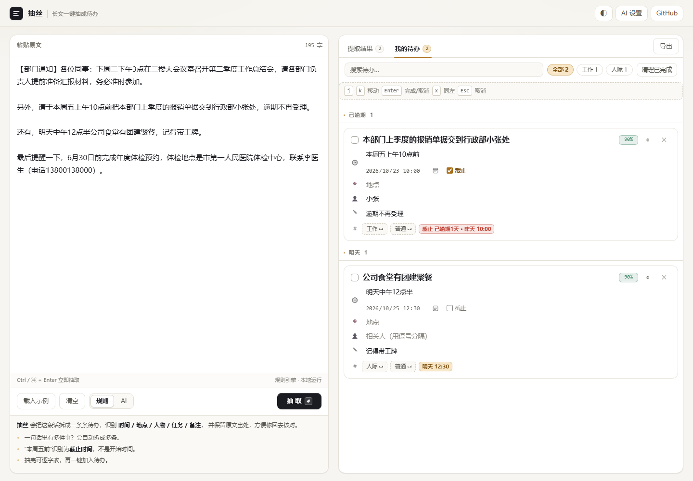

# 抽丝 · chousi

> 把一大段文字，抽成一条条能执行的待办。

[](https://github.com/embers1117/chousi/actions/workflows/ci.yml)


同事在群里发了一屏通知、邮箱里躺着一封会议纪要、老师布置了一堆事——你不想再手动拆成待办。
**抽丝**做的就是这件事：粘一段话，它把 **时间 / 地点 / 人物 / 任务 / 备注 / 优先级** 抽出来，变成一张张可以直接改、直接用的待办卡片。

- 🫙 **纯前端、零依赖、离线可用**：一个 HTML 文件，双击就开，不联网、不上传、不注册。
- 🧠 **规则引擎为主**：内置中文时间/地点/人物识别，不需要 API Key。
- ✨ **大模型可选增强**：填个自己的 Key，语义理解更强；失败自动回落到规则引擎。
- 🔎 **出处可回证**：每条待办都能展开看到原文，并高亮它依据的那句话。
- 📤 **导出**：Markdown / 日历 `.ics` / JSON / 纯文本。



---

## 30 秒上手

**方式一（最省事）**：打开 `dist/chousi.html`，双击即可。这是打包好的单文件版，飞书/微信发给别人也能直接打开。

**方式二（本地预览）**：

```bash
npm run dev          # 打开 http://127.0.0.1:5173
```

**方式三（GitHub Pages）**：仓库 Settings → Pages → 选 `main` / 根目录，直接访问即可（根目录用的是原生 ES Module，不需要构建）。

没有 `npm` 也没关系，这个项目**不需要安装任何依赖**，`node tools/serve.mjs` 就够了。

---

## 它是怎么"抽"的

粘贴这段：

```
【部门通知】各位同事：下周三下午3点在三楼大会议室召开第二季度工作总结会，请各部门负责人
提前准备汇报材料，务必准时参加。

另外，请于本周五上午10点前把本部门上季度的报销单据交到行政部小张处，逾期不再受理。

还有，明天中午12点半公司食堂有团建聚餐，记得带工牌。

最后提醒一下，6月30日前完成年度体检预约，体检地点是市第一人民医院体检中心，联系李医生（电话13800138000）。
```

得到 4 条待办：

| 标题 | 时间 | 地点 | 人物 | 备注 | 分类 |
|---|---|---|---|---|---|
| 召开第二季度工作总结会 | 5/14 周三 15:00 | 三楼大会议室 | — | 请各部门负责人提前准备汇报材料；务必准时参加 | 工作 |
| 报销单据交到行政部小张处 | 5/9 周五 10:00 ⏳截止 | — | 小张 | 逾期不再受理 | 钱款 |
| 公司食堂有团建聚餐 | 5/8 周四 12:30 | — | — | 记得带工牌 | 人际 |
| 完成年度体检预约 | 6/30 周一（全天）⏳截止 | 市第一人民医院体检中心 | 李医生 | 电话：13800138000 | 健康 |

一条待办的数据长这样：

```json
{
  "title": "报销单据交到行政部小张处",
  "due": "2025-05-09T10:00",
  "dueText": "本周五上午10点前",
  "deadline": true,
  "precision": "minute",
  "place": "",
  "people": ["小张"],
  "notes": "逾期不再受理",
  "priority": "normal",
  "category": "money",
  "confidence": 0.78
}
```

---

## 能认哪些时间

规则引擎覆盖的是中文里最常见的表达，全部会被换成**具体日期**再存：

| 你写的 | 解析成（假设今天是 2025-05-07 周三） |
|---|---|
| 明天上午9点 / 后天下午3点半 | 5/8 09:00 / 5/9 15:30 |
| 下周三下午3点 | 5/14 15:00 |
| 周五 / 周一 | 本周五 5/9 / 下周一 5/12（已过就顺延到下周） |
| 下下周五 | 5/23 |
| 本周五上午10点**前** | 5/9 10:00，并标记为**截止** |
| 6月30日 / 2026年1月1日 / 2025-05-09 | 对应日期 |
| 下个月15号 / 15号前 / 5号 | 6/15 / 5/15 / 6/5（已过就下个月） |
| 月底 / 今年年底 | 5/31 / 12/31 |
| 三天内 / 两个小时后 / 半小时后 | 相对当前时间推算 |
| 9:00-11:00 / 晚上7点半到9点 | 解析成**时间段**（起止都存） |
| 今晚8点 / 凌晨2点 / 下午两点 | 20:00 / 次日 02:00 / 14:00 |
| 尽快 / 待定 | 不硬塞日期，只提示"时间表述模糊" |

**不认**的：农历、节假日名（"国庆""中秋"）、"隔三差五"这类模糊频率、英文长句（只认 `tomorrow` 这类常见词的一部分）。这些都在路线图里。

## 能认哪些地点

- 显式：`地点：三楼会议室`、`地址是……`
- 介词 + 场所后缀：`在/于/到/去 + …会议室 / 办公室 / 教室 / 酒店 / 大厅 / 楼 / 层 / 室 / 站 / 路 …`
- 线上会议：`腾讯会议（会议号 123-456-789）`、`Zoom`、`钉钉`、`微信群`、会议链接

## 人物

- 职务式：`张老师`、`李医生`、`王经理`
- 昵称式：`行政部小张`、`交给老王`
- `@某某`、`负责人：某某`
- 顺带把手机号抽出来放进备注

## 备注与优先级

- 备注线索：`携带 / 带上 / 记得 / 别忘 / 逾期 / 否则 / 费用 / 材料 / 注意 / 要求`
- 优先级：`重要 / 紧急 / 务必 / 尽快 / 马上` → **重要**；`有空 / 不急 / 可选` → **不急**

---

## 界面

左右两栏：

- **左**：粘贴框（也能把 `.txt` / `.md` 拖进来）+ 引擎切换（规则 / AI）+ `Ctrl/⌘ + Enter` 直接抽取
- **右**：「提取结果」和「我的待办」两个页签
  - 提取结果里每张卡片都能**直接改**，右上角是置信度，点 `◎` 展开原文并高亮依据句
  - 待办按 **已逾期 / 今天 / 明天 / 本周内 / 以后 / 没有时间 / 已完成** 自动分组
  - 支持搜索、按分类筛选、一键清理已完成



快捷键只有一个但很关键：**`Ctrl / ⌘ + Enter` 立即抽取**。

## 导出

| 格式 | 用途 |
|---|---|
| Markdown `.md` | 贴进 Notion / Obsidian / 周报 |
| 日历 `.ics` | 导入手机日历，带时间的有提醒（提前 30 分钟） |
| JSON `.json` | 完整备份，含原文出处 |
| 纯文本 `.txt` | 纯勾选清单 |

## 数据存在哪

全部在你浏览器的 `localStorage` 里（键名 `chousi.state.v1`）。没有后端、没有账号、没有埋点。
换电脑就导出 JSON 再导入；清浏览器数据会丢，重要内容建议定期导出。

---

## 大模型增强（可选）

默认的规则引擎完全离线。想要更强的语义理解（比如一段口语化很重的话），可以接任意 **OpenAI 兼容**接口：

1. 点右上角 `AI 设置` → 选服务商（DeepSeek / OpenAI / Moonshot / 自定义）→ 填 Key → 测试连接 → 保存
2. 保存后引擎会自动切到 `AI`，抽取失败会自动回落到规则引擎并提示原因

**关于 CORS**：浏览器直连多数厂商接口会被拦住（`Failed to fetch`）。仓库自带一个 30 行的本地转发器：

```bash
npm run proxy   # 默认转发到 https://api.deepseek.com/v1
# 或者指定上游、用环境变量塞 Key（这样页面上的 Key 可以留空）
UPSTREAM=https://api.moonshot.cn/v1 KEY=sk-xxx npm run proxy
```

然后把界面的「接口地址」填成 `http://127.0.0.1:8787/v1` 即可。代理只监听 `127.0.0.1`，不落盘、不记录 Key。

---

## 目录结构

```
chousi/
├── index.html               # 单页外壳（含卡片模板）
├── src/
│   ├── app.js               # 界面接线：事件、渲染、导出
│   ├── extract.js           # 抽取流水线：切块 → 认事件单元 → 填字段 → 去重
│   ├── time.js              # 中文时间解析（本项目的心脏）
│   ├── fields.js            # 地点 / 人物 / 优先级 / 分类
│   ├── model.js             # 纯数据层：分组、过滤、md / ics 导出
│   ├── store.js             # localStorage 读写
│   ├── llm.js               # 可选的大模型适配
│   ├── util.js              # 小工具（归一化、中文数字、相似度）
│   └── styles.css           # 唯一样式表（无框架、无外链）
├── tests/                   # node:test 单测（80 条）
├── tools/
│   ├── serve.mjs            # 零依赖静态服务器
│   ├── bundle.mjs           # 打包成单文件 dist/chousi.html
│   ├── llm-proxy.mjs        # AI 模式用的本地 CORS 转发
│   └── run-tests.mjs        # 一次跑完所有测试（不 spawn 子进程）
├── dist/chousi.html         # 构建产物（双击即用）
└── docs/OUTLINE.md          # 设计提纲：为什么这么拆
```

## 开发

```bash
npm test        # 跑全部单测（不装依赖，Node 18+ 即可）
npm run eval    # 抽取准确率报表（条数/时间/地点/备注 各对多少）
npm run build   # 重新生成 dist/chousi.html
npm run dev     # 本地预览
```

测试覆盖四类东西：

1. **时间解析**：34 条表驱动用例，固定"现在 = 2025-05-07 周三 10:00"逐条比对
2. **分段回归**：15 条，专治"一件事被拆成多条 / 地点变待办 / 备注变待办"——
   `明天下午3点开会，4点半结束`、`时间：… 地点：… 内容：…`、`2点签到，3点开始，5点结束` 这类真实输入
3. **抽取流水线**：真实通知/清单文本，断言条数、时间、地点、人物、备注
4. **契约**：`app.js` 里用到的每个 `id` / `data-field` / `data-act` 必须在 `index.html` 里真实存在，关键 CSS 选择器必须在 `styles.css` 里存在（防止运行时静默 `null`）

### 准确率评估

`npm run eval` 跑的是**打分报表**而不是断言：14 条真实语料上，逐条对比「抽出的条数 / 时间 / 标题 / 地点 / 备注 / 人物」：

```
用例                  条数    时间  标题  地点  备注  其他
A 起止时间            1/1     ✓     ✓     ✓     ✓    ✓ ✓
B 表单三行            1/1     ✓     ✓     ✓     ✓    ✓ ✓
...
条数完全正确  14/14 (100.0%)   多抽 0 条 / 漏抽 0 条   全字段正确 14/14
```

CI 里会跑 `npm run eval -- --strict`，条数或时间低于 90% 直接挂。改规则前先跑一次、改完再跑一次，
就能看出这次改动到底让效果变好还是变差。

## 已知限制

- 以**中文**为主；英文只覆盖少量常见词
- 一段话里塞了三件以上且**没有明显分隔**时，可能拆得不理想（有列表符号时会好很多）
- 标题是从原文里"剪"出来的动宾短语，不是生成的，所以偶尔会带上多余的修饰词——所以每张卡片都能直接改
- 置信度是启发式打分，不是概率

## 路线图

- [ ] 移动端布局打磨 + PWA 离线安装
- [ ] 多端同步（不想做账号的话，走 WebDAV / 坚果云 / 自建极简后端）
- [ ] 节日与农历（国庆、中秋、春节前后）
- [ ] 周期任务（每周五、每月 15 号）
- [ ] 浏览器插件：选中网页文字右键生成待办
- [ ] 英文与日文规则包

## 贡献

欢迎提 issue 和 PR。加规则时请顺手在 `tests/` 里补一条用例——这个项目的规则是靠用例兜住的。

## License

[MIT](LICENSE)

---

[English README](README.en.md)
